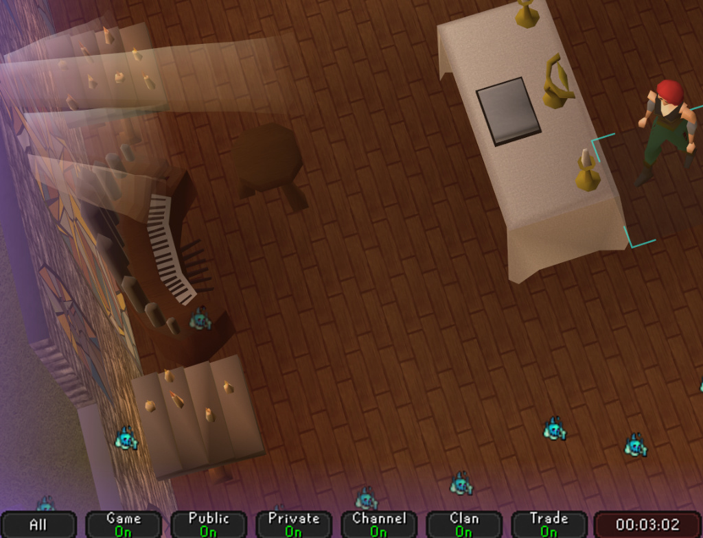

# Immersive Combat Overlays

A unified RuneLite plugin combining inventory/potion cooldown overlays, procedural health & status screen overlays, and combat spell recast/expiry reminders.

## Features

- **Combat spell reminders**: Resurrect Thrall, Death Charge, Mark of Darkness, Ward of Arceuus, Shadow Veil, Corruption, Vengeance, Vengeance Other and Charge are tracked until they can be recast (the later of the buff ending and the recast cooldown), using the same game varbits and durations as RuneLite's Timers & Buffs. Cooldowns are drawn on the spellbook (Resource Pack aware), ready spells and the Magic tab glow, and reminders only appear for the spellbook you are on.
- **Recast protection**: left-click Cast is deprioritized while a spell cannot be recast yet: a thrall still up, Vengeance still charged, or any tracked spell on its recast cooldown. Each spell has its own toggle (Mark of Darkness is off by default, Charge has none); right-click still casts.
- **Menaphite divine guard**: left-click Drink on a Menaphite remedy is deprioritized while a divine potion or saturated heart boost is running, because the remedy removes divine effects.
- **Inventory cooldowns**: Imbued/Saturated Heart, Surge, divine/antifire/stamina/anti-poison/anti-venom/goading/menaphite/moonlight/prayer regeneration potions, raid consumables, and combo-eat / Hunter meat timers, with left-click re-dose protection.
- **Expiry-only reminders**: Heart, potion and boost reminders fire when something you used runs out, never just because a potion is in your inventory. Optional pre-reminders for boosts (Heart, divines/overloads/salts, boost potions).
- **Per-stat re-dose levels**: e.g. remind when Ranged drops to +7 and Defence to +5 (Preserve-aware decay estimate).
- **Status warnings**: low HP, damage flash (scaled by % of max HP, minimum-damage threshold), low prayer, poison, venom, disease, freeze, idle, special attack ready, low run energy, unpotted-in-combat and the Nightmare parasite.
- **Consistent settings**: every warning and spell section has the same layout (Enable, options, Color, Screen glow, Shower icon, extra glow, Notification, Reminder duration, Debug preview), its own reminder duration and its own RuneLite notification (sound / tray / flash). Global *Allow* switches and Minimal / Standard / Everything presets sit in the shared sections at the top.
- **Lightweight rendering**: cached vignette paints with seamless rounded corners, nothing drawn while idle, memoised item classification.

## Running in Developer Mode

```bash
./gradlew run
```

## Screenshots

### Spell Cooldowns & Resource Pack Outlines


### Magic Tab & Inventory Item Silhouette Glow


### Spell Ready Screen-Edge Glow & Icon Shower


### Multi-Status Vignette & Combined Icon Shower

