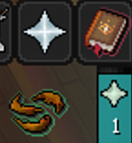

# Combat Auras

A RuneLite plugin that turns combat timers into auras: screen glows, icon showers and inventory highlights. It combines inventory/potion cooldown overlays, procedural health & status screen overlays, and combat spell recast/expiry reminders.

## Features

- **Combat spell reminders**: Resurrect Thrall, Death Charge, Mark of Darkness, Ward of Arceuus, Shadow Veil, Corruption, Vengeance, Vengeance Other and Charge are tracked until they can be recast (the later of the buff ending and the recast cooldown), using the same game varbits and durations as RuneLite's Timers & Buffs. Cooldowns are drawn on the spellbook (Resource Pack aware), ready spells and the Magic tab glow, and reminders only appear for the spellbook you are on. Shadow Veil is reminded while pickpocketing (configurable) and Charge only while a god cape is worn.
- **Recast protection**: left-click Cast is deprioritized while a spell cannot be recast yet: a thrall still up, Vengeance still charged, or any tracked spell on its recast cooldown. Each spell has its own toggle (Mark of Darkness is off by default, Charge has none); right-click still casts.
- **Menaphite divine guard**: left-click Drink on a Menaphite remedy is deprioritized while a divine potion or saturated heart boost is running, because the remedy removes divine effects.
- **Inventory cooldowns**: Imbued/Saturated Heart, Surge, divine/antifire/stamina/anti-poison/anti-venom/goading/menaphite/moonlight/prayer regeneration potions, raid consumables, with left-click re-dose protection.
- **Eat / drink delays**: food, combo food (karambwan, halibut, gnome food), potions, barbarian mixes and Varlamore hunter meat follow the game's separate food, combo and potion timers, so combo eats show correctly. Items are recognised from their real Eat/Drink actions (raw, burnt, noted items and furs never match), and a lock only starts once the item is actually consumed.
- **Expiry-only reminders with expiring-soon warnings**: Heart, potion and boost reminders fire when something you used runs out, never just because a potion is in your inventory. Every spell, the Heart, boost potions and each potion family (stamina, antifire, divine, overload / salts, surge, goading, prayer regeneration, other) has its own *Warn early* lead; antipoison and anti-venom expiry show as the Poison / Venom warning, with their own lead in those sections, so the reminder can start a few seconds before it expires.
- **Per-stat re-dose levels**: e.g. remind when Ranged drops to +7 and Defence to +5 (Preserve-aware decay estimate).
- **Status warnings**: low HP, damage flash (scaled by % of max HP, minimum-damage threshold), low prayer, poison, venom, disease, freeze, idle, special attack ready, low run energy, unpotted-in-combat (only XP backed by a hit you dealt counts, so teleports, alchemy, lamps and utility casts never trigger it).
- **Consistent settings**: every warning and spell section has the same layout (Enable, options, Color, Screen glow, Shower icon, extra glow, Notification, Reminder duration, Visual style, Debug preview), its own reminder duration and its own RuneLite notification (sound / tray / flash). Global *Allow* switches and Minimal / Standard / Everything presets sit in the shared sections at the top, along with four *Visual Style* sections: pick one per reminder to give it its own glow edges, strength, depth, tint, motion and shower movement.
- **Combat detection**: combat starts from what you click (Attack, an attack spell) or hits you deal or take. Talking, trading, following, pickpocket stuns, utility spells such as Vengeance Other, and poison or venom ticks do not count.
- **Glow edges**: choose any combination of top, bottom, left and right screen edges; corners blend only where two enabled edges meet, and a single edge runs cleanly through the corners.
- **One look across every system**: a single *Motion strength* drives every animation (screen pulses, the low-HP heartbeat, shower sway, and pulsing, breathing or sweeping icon glows; 0% holds them steady). *Item & spellbook glow strength* (25 to 200%) brightens or dims glows on inventory items, spell icons, the Magic tab and the spec orb, and *Icon opacity* (default 66%) sets how solid showering icons are. Every icon aura (spell icons, the Magic tab, the spec orb, prayer restores) can pulse or stay steady. Every lasting screen glow can use Low Health's heartbeat pulse, and everything new fades in over one game tick (600 ms) instead of popping in.
- **Lightweight rendering**: cached vignette paints, nothing drawn while idle, settings read from an immutable snapshot (rebuilt only when settings change) instead of per frame, and one cached classification per item id.

## Installing

Open RuneLite, go to the **Plugin Hub** (the plug icon in the sidebar), search for **Combat Auras** and install it.
Settings are under the wrench icon; every section starts collapsed, with shared options at the top.

## Known limitations

- **Combat detection is a heuristic.** Combat starts from clicks (Attack, attack spells) and hits you deal or take.
  It can miss fights started in unusual ways and ends 17 ticks (~10 s) after the last activity.
- **Some timers come from chat messages** (thrall length, Mark of Darkness, Ward of Arceuus, Shadow Veil). If you turn the plugin on mid-effect, those timers are unknown or estimated until the next cast.
  Timers backed by game variables (potions, hearts, recast cooldowns) are exact.
- **After logging in during a spell cooldown**, the game only says "on cooldown", so the full cooldown length is
  shown until it clears, as in RuneLite's Timers & Buffs.
- **Dwarf cannon XP** counts for the Unpotted alert only if the game attributes cannon hits to you.

## Troubleshooting

- **A reminder never shows:** check the section's *Enable*, *Only remind in combat* and, for spells, that you are on
  that spellbook. Spell reminders also need one cast since login unless *Only remind after cast* is off.
- **A reminder shows too long or too short:** each section has its own *Reminder duration* (0 = until re-applied)
  and *Warn early* lead.
- **Icons look wrong with a resource pack:** toggle Resource Packs or this plugin off and on to rebuild the icons.
- **Reset everything:** use the *Reset* button at the bottom of the plugin's settings, or pick the *Standard* preset
  to reset the main toggles only.
- **Debug previews:** the *Shared Debug Tools* section and each section's *Debug preview* show an effect without
  waiting for it in game. They switch themselves off on the next client start.

## Notifications and privacy

Each warning can send a RuneLite notification (all off by default); RuneLite's own notification settings and your
OS decide how they appear. The plugin makes no network requests and stores nothing outside RuneLite's config.

## Threading contract

- **Client thread:** every RuneLite game event (game tick, varbits, hitsplats, menu clicks, chat), the menu
  protection on client tick, and overlay rendering. All tracker state is owned by this thread.
- **Swing thread:** `ConfigChanged` and `PluginChanged`. The handler only swaps the immutable settings snapshot
  (behind a `volatile` reference) and hands everything else (cache clears, debug timers, simulated combat) to the
  client thread with `ClientThread.invokeLater`.
- **Per game tick:** trackers update first, then the reminder pipeline, then the status overlay's sampled values,
  then notifications. Render code only reads what the tick produced plus time-based fades.

## Adding content

Each tracked thing is defined once:

- **Spell / warning / reminder family / potion family**: an enum entry (`CombatSpell`, `StatusEffect`, `ReminderFamily`, `PotionFamily`), its `@ConfigItem` block, and one row in `settings/Bindings`. Tests fail if any entry has no binding.
- **Potion, boost or food**: a name rule in `PotionItems` (timed potions and boosts) or `FoodCooldownTracker.classify` (eat / drink timers). `ConsumableCatalog` caches the result per item id and logs unrecognised dosed potions at debug level.
- **New behaviour**: a `@Singleton` module bound in the plugin's `configure()`, plus one line in the matching event handler.

## Screenshots

### Spell Cooldowns & Resource Pack Outlines

### Magic Tab & Inventory Item Silhouette Glow

### Spell Ready Screen-Edge Glow & Icon Shower

### Multi-Status Vignette & Combined Icon Shower

### Different visual styles + Idle indicator

### Different visual styles

