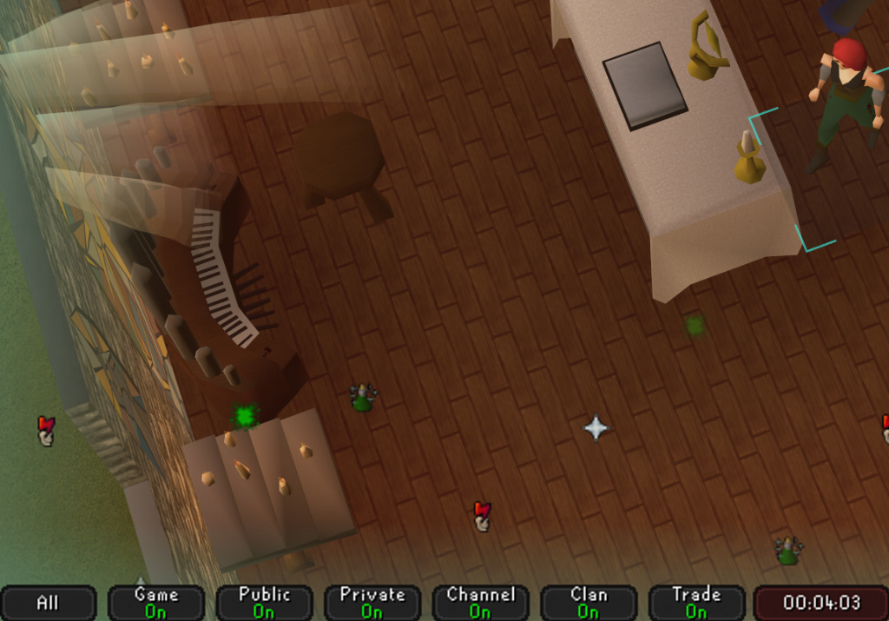

# Immersive Combat Overlays

A unified RuneLite plugin combining inventory/potion cooldown overlays, procedural health & status screen overlays, and combat spell recast/expiry reminders.

## Features

- **Combat Spell Overlays & Reminders**:
  - Tracks **Resurrect Thrall**, **Death Charge**, **Mark of Darkness**, **Ward of Arceuus**, **Shadow Veil**, **Corruption**, **Vengeance**, **Vengeance Other**, **Disruption Shield**, and **Charge** on next recast time.
  - Overlays active cooldowns directly on spellbook widgets while preserving your active Resource Pack sprites.
  - Glows all expired/ready spells in the spellbook simultaneously and glows the Magic spellbook tab icon.
  - Blends multiple expired spell screen-edge colors together and showers split/interleaved spell icons from the top of the screen.
  - Optional combat-only mode with configurable break re-remind (default 120s).
- **Inventory Cooldowns & Re-dose Protection**:
  - Tracks Imbued/Saturated Heart, Surge/potions/raid consumables, and Preserve-aware stat boost potions with left-click re-dose protection.
- **Health & Status Screen Overlays (Zero-Allocation)**:
  - Low HP vignette/pulse/blood splatter, damage hit flashes, poison/venom/disease glows, low prayer falling symbols, and freeze ice crystal borders.
  - Optimized to avoid per-frame heap allocations with configurable downsample step and FPS cap.

## Running in Developer Mode

```bash
./gradlew run
```

## Screenshots

### Spell Cooldowns & Resource Pack Outlines


### Magic Tab & Inventory Item Silhouette Glow


### Spell Ready Screen-Edge Glow & Icon Shower


### Multi-Status Vignette & Combined Icon Shower

