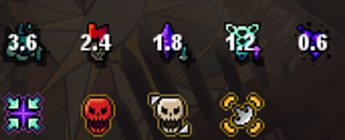

# Immersive Combat Overlays

A unified RuneLite plugin combining inventory/potion cooldown overlays, procedural health & status screen overlays, and combat spell recast/expiry reminders.

## Features

- **Combat spell reminders**: Resurrect Thrall, Death Charge, Mark of Darkness, Ward of Arceuus, Shadow Veil, Corruption, Vengeance, Vengeance Other and Charge are tracked until they can be recast (the later of the buff ending and the recast cooldown), using the same game varbits and durations as RuneLite's Timers & Buffs. Cooldowns are drawn on the spellbook (Resource Pack aware), ready spells and the Magic tab glow, and reminders only appear for the spellbook you are on. Shadow Veil is reminded while pickpocketing (configurable) and Charge only while a god cape is worn.
- **Recast protection**: left-click Cast is deprioritized while a spell cannot be recast yet: a thrall still up, Vengeance still charged, or any tracked spell on its recast cooldown. Each spell has its own toggle (Mark of Darkness is off by default, Charge has none); right-click still casts.
- **Menaphite divine guard**: left-click Drink on a Menaphite remedy is deprioritized while a divine potion or saturated heart boost is running, because the remedy removes divine effects.
- **Inventory cooldowns**: Imbued/Saturated Heart, Surge, divine/antifire/stamina/anti-poison/anti-venom/goading/menaphite/moonlight/prayer regeneration potions, raid consumables, with left-click re-dose protection.
- **Eat / drink delays**: food, combo food (karambwan, halibut, gnome food), potions, barbarian mixes and Varlamore hunter meat follow the game's separate food, combo and potion timers, so combo eats show correctly. Items are recognised from their real Eat/Drink actions (raw, burnt, noted items and furs never match), and a lock only starts once the item is actually consumed.
- **Expiry-only reminders with expiring-soon warnings**: Heart, potion and boost reminders fire when something you used runs out, never just because a potion is in your inventory. Every spell, the Heart, boost potions and each potion family (stamina, antipoison, antifire, divine, overload / salts, surge, goading, prayer regeneration, other) has its own *Warn early* lead, so the reminder can start a few seconds before it expires.
- **Per-stat re-dose levels**: e.g. remind when Ranged drops to +7 and Defence to +5 (Preserve-aware decay estimate).
- **Status warnings**: low HP, damage flash (scaled by % of max HP, minimum-damage threshold), low prayer, poison, venom, disease, freeze, idle, special attack ready, low run energy, unpotted-in-combat (only XP backed by a hit you dealt counts, so teleports, alchemy, lamps and utility casts never trigger it) and the Nightmare parasite.
- **Consistent settings**: every warning and spell section has the same layout (Enable, options, Color, Screen glow, Shower icon, extra glow, Notification, Reminder duration, Debug preview), its own reminder duration and its own RuneLite notification (sound / tray / flash). Global *Allow* switches and Minimal / Standard / Everything presets sit in the shared sections at the top.
- **Combat detection**: combat starts from what you click (Attack, an attack spell) or hits you deal or take. Talking, trading, following, pickpocket stuns, utility spells such as Vengeance Other, and poison or venom ticks do not count.
- **Glow edges**: choose any combination of top, bottom, left and right screen edges; corners blend only where two enabled edges meet, and a single edge runs cleanly through the corners.
- **Lightweight rendering**: cached vignette paints, nothing drawn while idle, settings read from an immutable snapshot (rebuilt only when settings change) instead of per frame, and one cached classification per item id.

## Adding content

Each tracked thing is defined once:

- **Spell / warning / reminder family / potion family**: an enum entry (`CombatSpell`, `StatusEffect`, `ReminderFamily`, `PotionFamily`), its `@ConfigItem` block, and one row in `settings/Bindings`. Tests fail if any entry has no binding.
- **Potion, boost or food**: a name rule in `PotionItems` (timed potions and boosts) or `FoodCooldownTracker.classify` (eat / drink timers). `ConsumableCatalog` caches the result per item id and logs unrecognised dosed potions at debug level.
- **New behaviour**: a `@Singleton` module bound in the plugin's `configure()`, plus one line in the matching event handler.

## Running in Developer Mode

```bash
./gradlew run
```

## Screenshots

### Spell Cooldowns & Resource Pack Outlines


### Magic Tab & Inventory Item Silhouette Glow


### Spell Ready Screen-Edge Glow & Icon Shower


### Multi-Status Vignette & Combined Icon Shower

